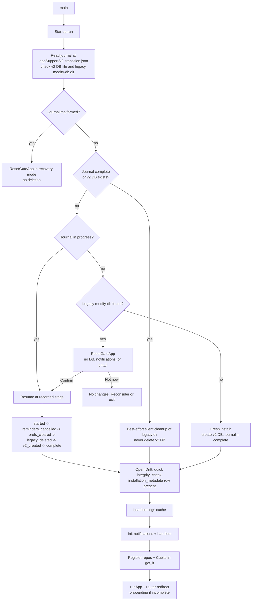

# Medify 2.0 system design

Audience: engineers working on this codebase. Companion to `docs/adr/0001-reset-legacy-objectbox-storage.md`.

Medify 2.0 is a local-only app (Android, iOS 15+, SPM only on iOS). Storage is Drift. DI stays manual `get_it`, errors stay `dartz` `Either<Failure, T>`, state stays Cubit. There are no accounts and no network.

## 1. Startup sequence

`main.dart` calls `Startup.run()` before `initializeDependencies()`. Code lives in `lib/core/startup/` (`legacy_detector.dart`, `transition_journal.dart`, `startup.dart`).

Rules to keep in mind:

- The gate runs before any DB, notification, background, or DI work. It is a separate minimal app.
- Journal writes are temp file, flush, then atomic `rename`. A missing journal with an existing v2 DB counts as v2.
- Every stage is idempotent so a kill at any point resumes cleanly.
- After the gate: open and verify Drift, then load settings, then init notifications, then register repos and Cubits, then run the UI. This reorders `lib/core/di/injection_container.dart`.
- The splash is native only. No artificial delay.

## 2. Data model

Database: `lib/core/database/app_database.dart`. In `beforeOpen`: `PRAGMA foreign_keys = ON`.

Conventions:

- Status and enum columns use `textEnum<T>()` (the name is stored, never the index) plus a `CHECK` that lists the allowed values.
- Instants are stored as UTC. Occurrences also keep a `local_date` snapshot so history is stable if the timezone changes. Future occurrences are generated from local rules, which handles DST.
- Schema snapshots live in `drift_schemas/` (`drift_dev schema dump`). Migration tests are generated with `drift_dev schema generate`.

Column lists below follow the plan's Phase 3 and the release plan. If the release plan adds a field, add it to the table here and in the snapshot at the same time.

| Table | Key columns | Constraints |
|---|---|---|
| `profiles` | `id` PK, `name`, `role` (patient/caregiver), `avatar`/colour, `is_archived`, `created_at` | `CHECK role IN (...)`. Local household: every profile is accessible on the device. |
| `medicines` | `id` PK, `patient_id` FK -> profiles, `name`, `dose_value`, `dose_unit`, `form`, `notes`, `stock_count`, `refill_threshold`, `status` (active/paused/stopped), `stop_reason`, `created_at` | `patient_id` FK. `CHECK status IN (...)`. `CHECK stock_count >= 0`. |
| `schedules` | `id` PK, `medicine_id` FK -> medicines, `times` (local HH:mm list), `weekdays` (bitmask or list), `start_date`, `end_date` nullable, `dose_quantity` | `medicine_id` FK (cascade). `CHECK` on weekday range and `end_date >= start_date`. |
| `occurrences` | `id` PK, `schedule_id` FK -> schedules, `medicine_id`, `patient_id`, `scheduled_at` (UTC), `local_date`, `status` (pending/snoozed/taken/skipped/missed), `resolved_at` nullable, `snoozed_until` nullable, `skip_reason` nullable, `prior_status`/`prior_resolved_at` for undo, `stock_decremented` | `UNIQUE(schedule_id, scheduled_at)`. `CHECK status IN (...)`. FKs on schedule, medicine, patient. |
| `achievements` | `id` PK, `patient_id` FK, `key`, `unlocked_at` | `UNIQUE(patient_id, key)`. |
| `settings` | `key` PK, `value` | Key/value store backing `PreferencesService`. Holds `selected_patient_id`, `actor_id`, theme, quiet hours, snooze duration, `missed_window`, stored IANA timezone name, onboarding flags. |
| `installation_metadata` | single row: `installation_id`, `schema_version`, `created_at` | Exactly one row. `installation_id` is rotated on delete-all. |

## 3. Repository contracts

Interfaces stay where they fit today: `MedicineRepository`, `MedicineLogRepository` (now meaning occurrences), `UserProfileRepository`. `ProfileService` and `CareLinkRepository` fold into `UserProfileRepository` plus the `selected_patient_id` and `actor_id` settings. `CareLinkModel` is removed.

Contracts:

- **Patient-scoped.** Every read and write takes `patientId`. Repositories must not read the acting patient from `getIt<PreferencesService>` or any other global. Tests assert patient isolation.
- **Transactional dose actions.** taken, skipped, missed, snooze, and undo each run inside one Drift `transaction` (occurrence row, stock, and any achievement or refill bookkeeping move together).
- **Exactly-once stock decrement.** A dose action is a conditional update: `UPDATE occurrences SET status = ... WHERE id = ? AND status IN ('pending','snoozed')`. The stock decrement happens only when exactly one row was updated. If zero rows changed, the repository returns `Left(AlreadyResolved)` and touches nothing else. Two concurrent Taken callbacks therefore decrement stock once.
- **Undo.** Restores the prior status, resolved time, and stock in one transaction. It fails with a Failure if the occurrence was not resolved by a dose action or the undo window has passed.
- **Schedule edit.** Deletes only future pending occurrences of that schedule and regenerates them. Resolved history is never changed.
- **Save from capture.** Medicine, schedule, and initial occurrences are written in one transaction. Undo of that save deletes them in one transaction, then cancels their notifications.
- **`PreferencesService`.** Keeps its public getters and setters, backed by the `settings` table and cached in memory after load. `SettingsCubit` and `my_app.dart` callers change very little.

## 4. Occurrence generation and reconciliation

`OccurrenceScheduler` replaces `DailyLogService` and `log_generator.dart`.

- Expands each active schedule (local times, weekdays, end date) into occurrences for a rolling window of today plus 7 days.
- Writes with an upsert on `UNIQUE(schedule_id, scheduled_at)`, so running it twice is harmless.
- Uses `tz` locations so DST days produce the right instants.

Reconciliation runs on startup, on `AppLifecycleState.resumed`, after any dose action, and when the stored IANA timezone name differs from the current one. Steps, in order:

1. Mark overdue pending items as `missed` once `missed_window` has passed. Missed is computed here; there is no background job package.
2. Extend the generation window.
3. Reschedule the notification diff (see section 5).
4. Run achievement and refill checks.

Reconciliation must be idempotent and safe to run concurrently with a dose action. The conditional update in section 3 guarantees that.

## 5. Notifications

`lib/core/notifications/notification_service.dart`.

- One one-shot `zonedSchedule` per pending occurrence. The notification ID is derived from the occurrence ID.
- **iOS 64-pending cap.** iOS keeps at most 64 pending local notifications. Medify schedules at most 60, nearest first, as a rolling window. Reconciliation on resume and after every action refills the window as doses resolve. Android uses the same code path for consistency.
- **Payload contract:** `{"installationId": "...", "occurrenceId": ...}`.
- **Rejection rules.** Ignore the payload (do not act, do not crash) when it is missing, not valid JSON, in the legacy shape (`medicineId`, `scheduledSeconds`), has a missing field, or carries an `installationId` that differs from the current `installation_metadata` row. A rotated installation ID after delete-all therefore invalidates every old notification.
- **Actions.** A `DarwinNotificationCategory` with Taken, Snooze, and Skip on iOS. Taken is also added on Android, where it had no handler.
- **Quiet hours** deliver reminders silently (low-importance channel on Android, passive interruption level on iOS). Reminders are never dropped.
- **Cold-start taps** are routed using `getNotificationAppLaunchDetails()`, and the router opens `/alarm` for that `occurrenceId`.
- The iOS sound file that was missing from `ios/Runner` must be bundled.

### Background isolate DB access

The action handler is a top-level function marked `@pragma('vm:entry-point')`. It runs without the UI isolate, so:

- It must not use `getIt`, `AppMessenger`, or any Cubit.
- It opens its own Drift connection through `drift_flutter` with `shareAcrossIsolates`, validates the payload, and calls the repository transaction directly.
- After acting, the foreground app picks up the change on next resume reconciliation or via the shared isolate stream.
- Drift's shared isolate behaviour is verified in the Phase 2 spike.

## 6. Backup container format

Code in `lib/features/backup/`.

- **Outer container:** a zip (via `archive`) containing:
  - `manifest.json`: format version, schema version, KDF parameters (algorithm, iteration count, salt), AES-GCM nonce.
  - `payload.bin`: AES-256-GCM ciphertext (includes the tag).
- **Payload plaintext:** a zip of a DB snapshot (`VACUUM INTO`), a settings dump, and the media files.
- **Key derivation:** PBKDF2-HMAC-SHA256 from the passphrase, with at least 600,000 iterations, recorded in the manifest. The key is never stored (so no `flutter_secure_storage`).
- **Integrity binding:** the manifest bytes are passed as AAD to GCM. Editing the manifest, the ciphertext, or the tag makes decryption fail.
- Libraries: `cryptography`, `archive`.

### Restore (staged)

1. Decrypt into `<appSupport>/restore_staging/`.
2. Validate: GCM tag, schema version (reject future versions), `PRAGMA foreign_key_check`, and that every media reference exists.
3. Close the DB and copy the current DB to `recovery/`.
4. Atomically rename the staged DB into place, reopen it, and reconcile notifications.
5. Any failure before step 4 leaves current data untouched. A failure at or after step 4 restores from `recovery/`.

Wrong passphrase and corrupted file both surface as the same user-facing "could not open backup" error, with no partial state.

## 7. Deletion flow

Settings -> Delete data:

1. User types `DELETE` to confirm. An export-first option is offered.
2. `cancelAll` notifications.
3. Close and delete the DB file and the app-owned media directory. Exported files outside app storage are not touched.
4. Rotate `installation_id` so stale notification payloads are rejected.
5. Navigate to onboarding.

## 8. Navigation map

`lib/app/app_router.dart` (`go_router`).

| Route | Purpose |
|---|---|
| `/home` | Tab 1. Next dose first, dose actions, timeline, 7-day chart, streak card. Absorbs old `/stats` and `/history`. |
| `/medicines` | Tab 2. List with filters, detail, history, edit / pause / stop with reason. |
| `/family` | Tab 3. Patient list, missed or skipped doses with reasons and filters, per-patient history. |
| `/settings` | Tab 4. Theme, accessibility, notifications and quiet hours, achievements, reports and backup, about / privacy / T&C, delete. |
| centre FAB | Opens the add-medicine sheet (manual, voice, camera). Not a tab. |
| `/alarm` | Keyed by `occurrenceId`. Target for notification taps. |
| `/achievements` | Kept. |
| `/onboarding` | What Medify does, permissions with reasons, role, profile, optional first medicine. |

Tabs use `StatefulShellRoute`. A `redirect` reads startup state and sends users with incomplete onboarding to `/onboarding`. A global `PatientCubit` drives the patient switcher, which is shown only when there are two or more patients.

## 9. Platform channels

| Channel | Methods | Notes |
|---|---|---|
| `medify/speech` | `listen()` returns transcript and confidence. `speak(text)`. | Apple Speech and `AVSpeechSynthesizer` on iOS. `SpeechRecognizer` and `TextToSpeech` on Android. Replaces `flutter_tts` and `lib/core/voice/reminder_voice.dart`. On permission denied or unsupported language, fall back to manual entry. |
| Timezone | `getLocalTimezone` returns an IANA name | Fixes the UTC fallback in `notification_service.dart`. The name is stored in settings to detect timezone change. |
| Legacy prefs clear | `clearLegacyPrefs` | Android clears `FlutterSharedPreferences`. iOS removes `UserDefaults` keys prefixed `flutter.`. Called only from the `prefs_cleared` stage. |
| OCR (conditional) | `recognizeText(imagePath)` | Only if the spike shows ML Kit needs CocoaPods on iOS. See the ADR. |

Required manifest entries: Info.plist `NSCameraUsageDescription`, `NSMicrophoneUsageDescription`, `NSSpeechRecognitionUsageDescription`, `NSPhotoLibraryUsageDescription`. Android `RECORD_AUDIO` and a `<queries>` entry for `RecognitionService`.

## 10. Accessibility requirements

- Minimum tap target 48 dp (`SpaceTokens.minTap` raised from 44).
- Respect `MediaQuery.textScaler`. Layouts must not clip at the largest scale (widget-tested).
- Support `highContrast` with a dedicated high-contrast token set.
- Respect `disableAnimations`: use `ChromeTokens.glassFallback`, skip confetti and staggered animations.
- `Semantics` labels on dose actions and status chips. Status is always icon plus text, never colour alone.
- Use `MedifyTokens.of(context)` rather than the light-only `AppColors`, so dark mode and high contrast work everywhere.
- Capture review screen is always shown, with low-confidence fields highlighted and an explicit patient binding.
- Verify with VoiceOver and TalkBack on real devices before release.
