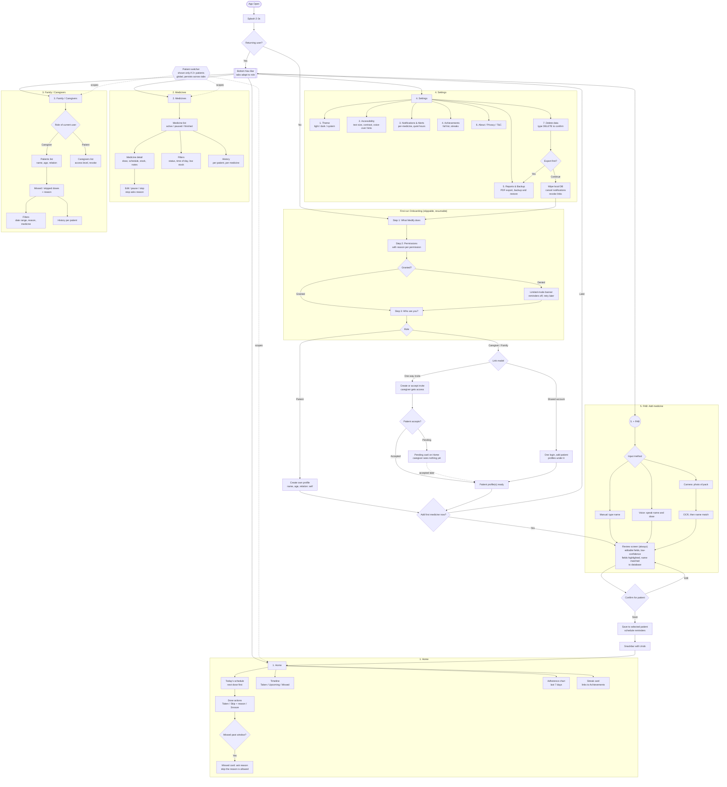

# Medify User Flow

Top-level navigation, onboarding, and role flows for Medify.

## Notes

- **Link model covers both cases.** One-way invite: caregiver is a separate account with scoped access, patient can revoke. Shared account: one login manages several profiles, no per-person permissions. Choose per patient, not app-wide.
- **Tabs adapt to role.** Patient sees "Caregivers" (access list). Caregiver sees "Patients" (missed doses, members). Same tab slot, different content.
- **Patient switcher is hidden with one patient.** Shows only when 2+ profiles exist, so single-patient users see no extra UI.
- **Review screen is the only save path** for manual, voice, and camera. Low-confidence OCR or voice fields are highlighted, so a wrong medicine name never saves silently.
- **Missed-dose reason is optional.** Asking is useful for the adherence report, but a required field would turn a forgotten dose into a chore. "Skip reason" and "no reason" are both valid.
- **Achievements moved toward Home.** Under Settings it is hard to find, so it appears as a streak card on Home and the full list stays in Settings.
- **Delete data offers export first.** Deleting health data is irreversible, so backup is the default, not an afterthought.

## Minimal architecture

- One dose-event model: `scheduled → taken | skipped(reason) | missed`. Home, adherence chart, history, and reports are all views of it.
- Offline-first local DB is the source of truth. Reminders fire without network. Sync is additive.
- BLoC per feature (Home, Medicines, Family, Settings, Add) plus one global `PatientScope` for the switcher and role.

## Open questions

- Settings → Delete data → Continue wipes DB and returns to onboarding. Confirm intended.
- Achievements shown on Home (streak card) and in Settings. Pick one source of truth.
- Stop medicine "asks reason" is not marked optional, unlike missed-dose reason. Confirm.
